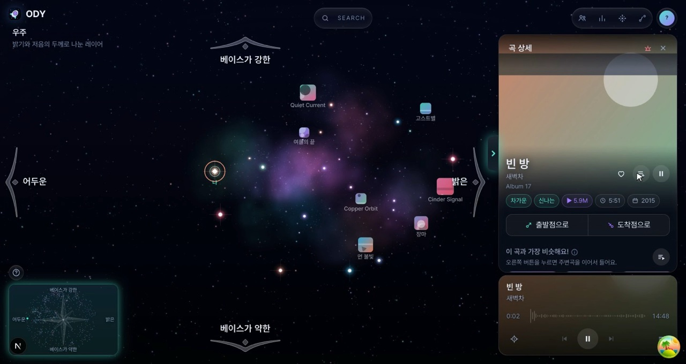

# ODY · 지도로 보는 음악 탐색

약 450만 곡을 음향 특성 16차원 좌표에 놓고, 추천이 이루어지는 공간 전체를 **지도처럼** 보여 주는 음악 탐색 서비스입니다.
지도를 확대하며 8겹 레이어로 취향을 좁혀 들어가고, 곡 주변을 둘러보거나 두 곡 사이를 잇는 여정을 따라 음악을 발견합니다.

> SSAFY 15기 특화 프로젝트 **2등** (2026.07 ~ 2026.09, 6명)
> 이 저장소는 프론트엔드 공개본입니다. 배포 백엔드가 종료되어 **목 데이터로 실행되는 데모 모드**가 기본입니다.

[](docs/media/demo.mp4)

**체험하기 → [ody-music-map.vercel.app](https://ody-music-map.vercel.app)** · 로그인 없이 바로 둘러볼 수 있습니다.

▶ [시연 영상](docs/media/demo.mp4) · [레이어 파고들기](docs/media/dive.mp4)

## 주요 기능

- **소리 지도** — 장르 칸 대신 소리 특징으로 곡을 배치합니다. 장르는 별 색과 필터로 남겼습니다.
- **레이어 파고들기** — 확대하면 그 영역의 곡만 다음 두 축(PCA)으로 다시 펼칩니다. 우주 → 은하단 → 우리은하 … 8겹.
- **주변 탐색 · 여정 탐색** — 지금 곡과 비슷한 곡, 두 곡 사이를 잇는 곡들을 지도 위에서 찾습니다.
- **실시간 따라가기** — 다른 사용자의 겹 이동·곡 선택·재생 시각까지 내 화면에 동기화합니다.

## 맡은 일

**기획·디자인 전담 / 프론트엔드 리드** — 서비스 기획, 화면 정의서(31개 → MVP 12개), UI 디자인, 지도 엔진·레이어 탐색·실시간 따라가기·BFF 구현

## 기술 스택

React 19 · Next.js 16 (App Router) · TypeScript · Zustand · TanStack Query · Tailwind CSS 4 · Canvas 2D · STOMP/WebSocket · YouTube IFrame

## 구현 포인트

| 무엇을 | 어떻게 | 결과 |
| --- | --- | --- |
| 별 1만 개 지도 그리기 | DOM 대신 캔버스 한 장, 좌표는 `Float32Array` | 상주 곡 850 → 7,200개(8.5배)에도 60fps, 한 화면 1.64ms |
| 지도 데이터 전송 | Next.js Route Handler(BFF)에서 압축 + ETag | 1.6MB → 0.56MB, 재방문 304 · LTE 재방문 2.5초 → 1.3초 |
| 레이어 전환 | 배율이 아니라 화면 안 곡 밀도로 전환 시점 판단 | 파고든 겹에서 화면 안 곡 40% → 96% |
| 엔진 테스트 | 엔진이 DOM에 의존하지 않게 분리 | 브라우저 없이 Node 테스트 562개 |

성능 개선 기록은 [docs/performance](docs/performance), 문제 해결 기록은 [docs/troubleshooting](docs/troubleshooting)에 있습니다.

- [앨범 커버가 줌할 때 통째로 바뀌며 반짝이던 문제](docs/troubleshooting/007-album-covers-flicker-on-zoom.md) — 한 프레임 최대 교체 7개 → 1개
- [배경 별밭이 그리기 시간의 88%를 먹던 문제](docs/performance/004-background-starfield.md) — 6.94 → 4.52ms/frame, 메모리 49 → 12MB
- [지도 데이터를 압축 없이 매번 받던 문제](docs/performance/005-map-songs-gzip-etag.md)

## 실행

```bash
npm install
cp .env.example .env.local   # 목 데이터 + 로그인 없는 데모 모드
npm run dev                  # http://localhost:3000
```

```bash
npm test        # 타입 체크 + 단위 테스트
npm run build   # 프로덕션 빌드
```

데모 모드에서는 로그인 없이 지도·곡 상세·주변 탐색·재생·친구·플레이리스트가 모두 목 데이터로 동작합니다. 재생은 곡과 상관없는 공개 샘플 영상으로 플레이어 동작만 보여 줍니다.

## 구조

```
src/
  app/          페이지, 레이아웃, BFF 라우트(src/app/bff)
  components/   map(지도 엔진·렌더) · minimap · player · panels · auth · layout …
  hooks/        queries · mutations · 지도/재생 훅
  lib/          API 클라이언트, BFF 공통, 계산 유틸
  stores/       Zustand 상태
  mocks/        데모 모드용 목 데이터
tests/          Node 단위 테스트
docs/           성능 · 트러블슈팅 기록
```
